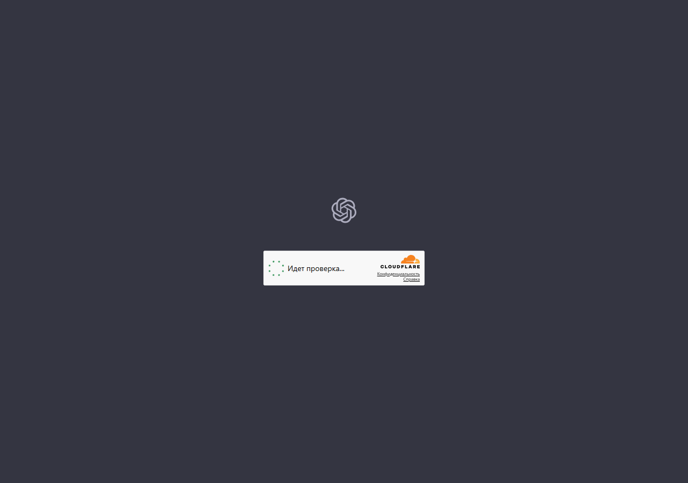

# AiBypass

Маленькая программа для Windows, которая возвращает доступ к ChatGPT, Gemini и Spotify
на сетях, где провайдер подменяет DNS-ответы (в России это ТСПУ).

Работает в двух режимах, оба — штатными средствами Windows, без драйверов, без VPN-туннеля
и без установки служб:

* **hosts** — домены из списка направляются на прокси-адрес, который отдаёт сторонний сервис;
* **NRPT** — правила разрешения имён: указанные домены резолвятся через заданный DNS-сервер
  (Name Resolution Policy Table, тот же механизм, что у корпоративных политик).

Меняются только домены OpenAI/Google AI/Spotify из списка в коде. Остальная сеть
не трогается: `ya.ru`, `github.com` и прочее резолвятся как обычно.

## Как это выглядит



## Скачать

Готовый `AiBypass.exe` лежит в [Releases](../../releases). Он собран из исходника в этом
репозитории компилятором .NET Framework (`csc.exe`), хеш указан в описании релиза.
Программа требует прав администратора — иначе `hosts` и правила DNS не изменить.

Можно собрать самому, тогда никакому чужому файлу доверять не нужно:

```bat
build.cmd
```

## Как пользоваться

Запустить `AiBypass.exe` (без аргументов) — откроется окно.

1. Нажать **«Взять адрес из GitHub»** — программа читает список прокси-адресов
   из репозитория сервиса и проверяет, какой из них реально пускает к сайтам.
2. Нажать **«Проверить»** — замер без изменений: покажет коды ответов и предупредит,
   если сертификат не совпадает.
3. Нажать **«Применить»** — домены прописываются в `hosts`, кэш DNS сбрасывается.
4. Кнопка **«Выключить»** убирает всё, что программа добавила.

Перед каждой правкой `hosts` делается резервная копия в папку `backup` рядом с exe,
хранятся последние 10.

### Из командной строки

```
AiBypass.exe --state                показать, что сейчас включено
AiBypass.exe --check 217.60.179.6   проверить адрес, ничего не меняя
AiBypass.exe --apply 217.60.179.6   прописать домены на адрес
AiBypass.exe --off                  убрать блок из hosts
AiBypass.exe --github               взять текущий адрес из репозитория сервиса
AiBypass.exe --find <ссылка|домен>  найти адрес по ссылке и проверить его
AiBypass.exe --nrpt-set 1.1.1.1     поставить DNS-правила на этот сервер
AiBypass.exe --nrpt-off             снять DNS-правила
```

## Важно понимать, что происходит

Это **не VPN**. Трафик не шифруется дополнительно и не идёт через туннель: браузер
по-прежнему соединяется с сайтом напрямую, просто по другому адресу, который подсказал
сторонний сервис.

Отсюда следствия, которые надо знать до применения:

1. **Адрес прокси — чужая инфраструктура.** Его отдаёт сервис
   [ASTRACAT2022/host-DNS](https://github.com/ASTRACAT2022/host-DNS). Владелец этого сервера
   видит, что вы подключаетесь к ChatGPT, когда и как часто, и ваш IP. Содержимое страниц
   он не видит, пока не подменяет сертификат.
2. **Подмена сертификата — красный флаг.** Если прокси расшифровывает трафик, он видит пароли
   и переписку. Программа это проверяет и пишет «сертификат не совпал» — в таком случае
   лучше ничего важного на сайте не вводить. Раньше эта проверка ничего не показывала,
   теперь показывает (см. «Что изменено»).
3. **Прокси-адреса живут недолго.** Их блокируют, они умирают. Поэтому кнопка «взять из
   GitHub» и проверка перед применением: слепое применение адреса из прошлого месяца
   скорее всего просто сломает доступ к сайтам.
4. **Обход блокировок — ваше решение и ваша ответственность.** В некоторых странах и у
   некоторых провайдеров это нарушает правила оказания услуг. Автор кода не призывает
   ничего нарушать и не даёт гарантий, что способ будет работать завтра.

## Что изменено по сравнению с исходной сборкой

Репозиторий — вычищенная версия личного инструмента. Перед публикацией исправлено два места,
которые в исходнике были опасны:

* **`HttpGet` больше не принимает любой TLS-сертификат.** Раньше проверка сертификата была
  отключена (`return true` в callback), а этим методом скачивается список прокси-адресов.
  То есть любой, кто окажется между вами и GitHub, мог подсунуть свой «прокси-адрес»,
  и весь трафик ChatGPT ушёл бы к нему. Теперь сертификат проверяется по-настоящему.
* **Проверка адреса показывает подмену сертификата.** `CheckSite` запоминает, совпал ли
  сертификат с именем сайта, а `FindAndVerify` по умолчанию пропускает такие адреса и берёт
  их только если рабочих без подмены нет — с явным предупреждением в логе.

Заодно убраны личные данные: внешний IP, домашние пути, локальные бэкапы `hosts` и журналы
замеров — в публичную версию они не попали.

## Структура

```
src/AiBypass.cs        вся программа: один файл, WinForms + консольные режимы
src/app.manifest       требует права администратора, объявляет поддержку Windows 10/11
build.cmd              сборка через csc.exe из состава Windows
scripts/               отдельные PowerShell-скрипты тех же задач (для ручной работы)
docs/                  журналы замеров: как проверялось, что не работает и почему
screenshots/           скриншоты
```

## Ограничения

* Только Windows (нужны `hosts`, NRPT и PowerShell).
* Список доменов фиксирован в коде — это не универсальный обходчик.
* Зависит от стороннего сервиса: если он перестанет отдавать адреса, останется ручной ввод.
* Windows 10 до сборки 2004 не умеет системный DNS-over-HTTPS, поэтому NRPT-режим там
  работает только через обычный DNS (и провайдер может его перехватить).

## Лицензия

Код выложен как есть, без лицензии и без гарантий. Делайте что хотите, но ответственность
за использование — на вас.
