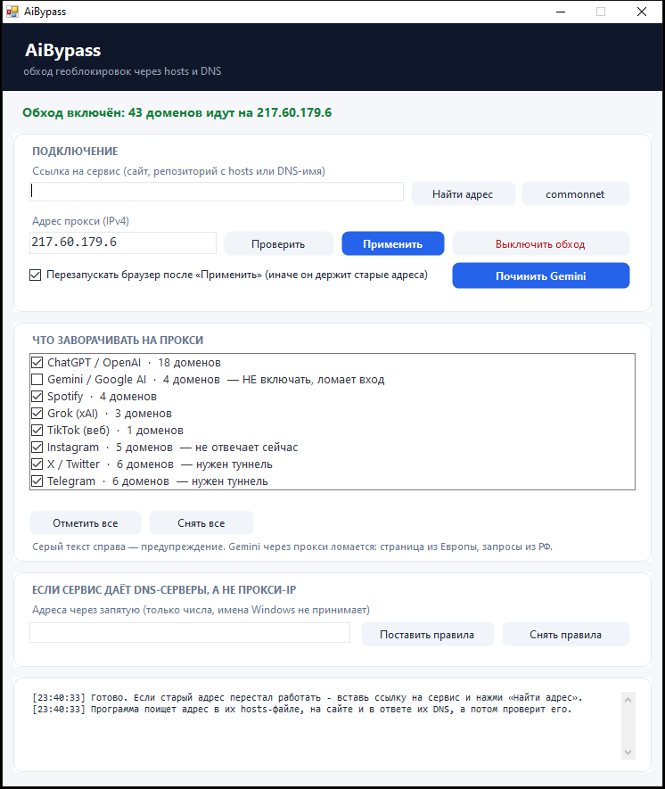

# AiBypass

Маленькая программа для Windows, которая возвращает доступ к ChatGPT, Gemini, Spotify, Grok
и другим сервисам на сетях, где провайдер подменяет DNS-ответы (в России это ТСПУ),
а также к сайтам, закрытым по стране.

Работает штатными средствами Windows — без драйверов, без VPN-туннеля и без установки служб:

* **hosts** — домены из списка направляются на прокси-адрес, который отдаёт сторонний сервис;
* **NRPT** — правила разрешения имён: указанные домены резолвятся через заданный DNS-сервер
  (Name Resolution Policy Table, тот же механизм, что у корпоративных политик).

Меняются только домены из списка. Остальная сеть не трогается: `ya.ru`, `github.com` и прочее
резолвятся как обычно.

## Как это выглядит



## Скачать

Готовый `AiBypass.exe` — в [Releases](../../releases), хеш указан в описании релиза.
Программа требует прав администратора: без них `hosts` и правила DNS не изменить.

Можно собрать самому, тогда никакому чужому файлу доверять не нужно:

```bat
build.cmd
```

Нужен только .NET Framework 4.x — он стоит в Windows по умолчанию.

## Как пользоваться

Запустить `AiBypass.exe` — откроется окно.

1. **Галочками** отметить, какие сервисы заворачивать на прокси. По умолчанию включено всё,
   кроме тех, что через прокси ломаются (Gemini). Выбор запоминается между запусками.
2. **«Найти адрес»** — вставить ссылку на сервис (сайт, репозиторий с файлом hosts или DNS-имя)
   и нажать. Программа сама достанет адрес прокси и проверит его.
3. **«Проверить»** — замер без изменений: покажет коды ответов и предупредит, если сертификат
   не совпал с именем сайта.
4. **«Применить»** — домены прописываются в `hosts`, кэш DNS сбрасывается. Если стоит галочка
   «Перезапускать браузер», программа закрывает и заново открывает запущенные браузеры.
5. **«Выключить обход»** убирает всё, что программа добавила.

### Кнопка «Починить Gemini»

Одно нажатие для случая «Gemini открывается, но пишет, что запрос не может быть обработан».
Программа делает всё, что для этого нужно:

1. убирает домены Gemini из `hosts` (остальные сервисы остаются на прокси);
2. сбрасывает кэш DNS Windows;
3. закрывает и заново открывает все запущенные браузеры — Chrome, Edge, Firefox, Opera,
   Яндекс, Brave, Vivaldi. Это и есть аналог «режима полёта» на телефоне: браузер держит
   собственный кэш адресов и пул открытых соединений в памяти, и `ipconfig /flushdns` их не чистит;
4. открывает `gemini.google.com` в браузере по умолчанию.

Внимание: несохранённые формы в браузере при этом пропадут.

Перед каждой правкой `hosts` делается резервная копия в папку `backup` рядом с exe,
хранятся последние 10.

### Когда сервис перестал работать

Адреса прокси живут недолго. Порядок: вставить ссылку на сервис → «Найти адрес» → «Применить».
Кнопка **«commonnet»** делает то же самое для текущего сервиса
([ASTRACAT2022/host-DNS](https://github.com/ASTRACAT2022/host-DNS)), чтобы не искать ссылку.

### Из командной строки

```
AiBypass.exe --state                     показать, что сейчас включено
AiBypass.exe --services                  список сервисов и доменов
AiBypass.exe --check 217.60.179.6        проверить адрес, ничего не меняя
AiBypass.exe --apply 217.60.179.6        прописать все домены на адрес
AiBypass.exe --apply 217.60.179.6 Grok   только выбранные сервисы (через запятую)
AiBypass.exe --off                       убрать блок из hosts
AiBypass.exe --find <ссылка|домен>       найти адрес по ссылке и проверить его
AiBypass.exe --github                    взять адрес из репозитория commonnet
AiBypass.exe --fix-gemini                убрать Gemini с прокси, сбросить DNS, перезапустить браузер
AiBypass.exe --restart-browser           только перезапустить браузер
AiBypass.exe --browsers                  какие браузеры сейчас запущены
AiBypass.exe --nrpt-set 1.1.1.1,8.8.8.8  поставить правила DNS
AiBypass.exe --nrpt-off                  снять правила DNS
```

## Что работает, а что нет

Замеры от 8 ноября 2026, сеть МТС (Екатеринбург), прокси `217.60.179.6`:

| Сервис | Напрямую | Через прокси | Вывод |
|---|---|---|---|
| ChatGPT / OpenAI | 403 `unsupported_country_region_territory` | **200**, `api` 401 | работает |
| Gemini / Google AI | — | через прокси **ломается** | держать **выключенным**: работает напрямую |
| Spotify | — | **200**, `accounts` 307 | работает |
| Grok (xAI) | 403 | **200** | работает |
| TikTok (веб) | 200 | 200 | открывается и так |
| Instagram | таймаут | таймаут | домены в списке сервиса есть, но прокси их не обслуживает |
| X / Twitter | таймаут | таймаут | сервис не обслуживает — нужен туннель |
| Telegram | таймаут | таймаут | режется соединение — нужен туннель или встроенный прокси |

Эти три сервиса оставлены в списке с пометкой: их домены уже прописаны, и в день, когда
сервис начнёт их обслуживать, достаточно нажать «Применить».

### Почему Gemini по умолчанию выключен

Прокси отдаёт только саму страницу `gemini.google.com`, а всё, чем приложение живёт,
идёт напрямую из России: `geminiweb-pa.clients6.google.com`, `alkalicore-pa.clients6.google.com`,
`people-pa.clients6.google.com`, `accounts.google.com`. Сервис их не проксирует — проверено
запросом к его DNS.

Получается несогласованная сессия: страница пришла из Европы, а её запросы уходят из РФ.
Google видит разные регионы и отвечает «не удалось обработать запрос» — снаружи это выглядит
как «сайт открылся, но ничего не работает».

Свести к одному региону нельзя, поэтому Gemini надо держать **выключенным**: он и так
работает напрямую (DNS-блокировки Gemini на момент 1.1.0 нет). В окне он помечен
«НЕ включать, ломает вход» и по умолчанию не отмечен; если отметить руками —
при нажатии «Применить» программа предупредит в журнале.

## Важно понимать, что происходит

Это **не VPN**. Трафик не шифруется дополнительно и не идёт через туннель: браузер
по-прежнему соединяется с сайтом напрямую, просто по другому адресу, который подсказал
сторонний сервис.

Отсюда следствия, которые надо знать до применения:

1. **Адрес прокси — чужая инфраструктура.** Его отдаёт сервис
   [ASTRACAT2022/host-DNS](https://github.com/ASTRACAT2022/host-DNS). Владелец этого сервера
   видит, что вы подключаетесь к ChatGPT, когда и как часто, и ваш IP. Содержимое страниц
   он не видит, пока не подменяет сертификат.
2. **Подмена сертификата — красный флаг.** Если прокси расшифровывает трафик, он видит пароли
   и переписку. Программа это проверяет: при расхождении сертификата пишет
   «сертификат не совпал: возможна расшифровка трафика» и такой адрес автоматически
   не подставляет — только предупредит, если рабочих без подмены нет.
3. **Прокси-адреса живут недолго.** Их блокируют, они умирают. Поэтому есть поиск адреса
   и проверка перед применением: слепое применение адреса из прошлого месяца скорее всего
   просто сломает доступ к сайтам.
4. **Обход блокировок — ваше решение и ваша ответственность.** В некоторых странах и у
   некоторых провайдеров это нарушает правила оказания услуг. Автор кода не призывает
   ничего нарушать и не даёт гарантий, что способ будет работать завтра.

## Безопасность

* Список адресов скачивается по HTTPS **с проверкой сертификата**. Раньше проверка была
  отключена, и перехватчик мог подсунуть свой «прокси-адрес», уведя весь трафик ChatGPT к себе.
  Так больше не будет — `HttpGet` в `src/Core.cs` проверяет сертификат по-настоящему.
* Перед правкой `hosts` всегда делается копия; откат — кнопкой «Выключить» или `--off`.
* Программа не ставит служб, не прописывается в автозапуск и не открывает портов.

## Структура

```
src/Services.cs        список сервисов, их домены и честный статус каждого
src/Core.cs            работа с hosts, проверка адресов, поиск по ссылке, правила DNS
src/Gui.cs             окно: карточки, скруглённые кнопки, список с галочками
src/Program.cs         точка входа и консольные команды
src/AssemblyInfo.cs    версия и атрибут .NET Framework 4.8 (без него ломается TLS)
src/app.manifest       права администратора, поддержка Windows 7–11
build.ps1 / build.cmd  сборка через csc.exe из состава Windows
docs/                  журналы замеров: что проверялось и чем кончилось
screenshots/           скриншоты
scripts/               отдельные PowerShell-скрипты тех же задач, для ручной работы
CHANGELOG.md           что менялось по версиям
```

## Ограничения

* Только Windows (нужны `hosts`, NRPT и PowerShell).
* Список доменов фиксирован в коде — это не универсальный обходчик.
* Зависит от стороннего сервиса: если он перестанет отдавать адреса, останется ручной ввод.
* Windows 10 до сборки 2004 не умеет системный DNS-over-HTTPS, поэтому NRPT-режим там
  работает только через обычный DNS (и провайдер может его перехватить).
* Instagram, X и Telegram этим способом не открываются — им нужен туннель, а не подмена адреса.

## Лицензия

MIT — см. [LICENSE](LICENSE). Гарантий нет, ответственность за использование на вас.
